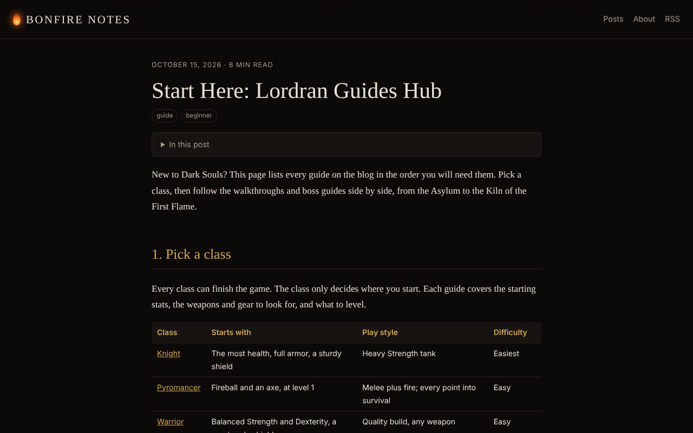

# Bonfire Notes

**▶ [Live demo](https://theoyanvno.github.io/bonfire-notes/)**

A Dark Souls fan blog with beginner guides, boss strategies and plain-language lore, built with a small **Python static site generator**. Posts are written in Markdown and turned into a fast, dark-themed site with floating embers.

**Tech:** Python · Markdown · Jinja2 templates · HTML/CSS · Canvas animation · RSS · `unittest` · GitHub Pages

| Home | Guides hub | Boss guide |
|---|---|---|
|  |  |  |

## Posts

A full Dark Souls guide, collected in the [guides hub](https://theoyanvno.github.io/bonfire-notes/posts/lordran-guide-hub.html):

- **10 class builds**, one for every starting class: starting stats, weapons, gear and what to level
- **20 area walkthroughs**, from the Northern Undead Asylum to the Kiln of the First Flame, plus the Artorias of the Abyss DLC
- **25 boss guides** with each boss's attacks, how to dodge them and a step-by-step strategy

Old build links forward to the new class guides, so bookmarks keep working.


- **Why Dark Souls Still Matters**: world design, fair difficulty and its legacy
- **Your First Hours in Lordran**: 10 beginner tips
- **Ornstein and Smough**: a calm guide to the Anor Londo duo
- **The Age of Fire, Explained**: the main story in plain words (spoilers)

## Features

- Write a post as a Markdown file with a small front matter block; run one command to publish
- Home page with post cards, reading time and tag filters, plus a page for every tag
- Each post gets heading anchors, a table of contents, newer/older links and a reading progress bar
- RSS feed, an About page, and social-friendly page descriptions
- Ember particles drift up the page (turned off for reduced-motion users); works on phones

## How it works

| File | What it does |
|---|---|
| [`build.py`](build.py) | Reads `posts/*.md`, parses front matter, converts Markdown to HTML, renders templates and writes the site to `docs/` |
| [`templates/`](templates) | Jinja templates: shared layout, post list, post page, About page |
| [`static/`](static) | Stylesheet and the ember/progress-bar script |
| [`tests/test_build.py`](tests/test_build.py) | Tests for front matter, slugs, reading time, a full build, moved-post redirects and links between posts |

## Write a post

Create `posts/2026-10-20-my-post.md`:

```markdown
---
title: My Post
date: 2026-10-20
tags: guide, boss
summary: One sentence that appears on the home page.
---

## A heading

Your text here.
```

Then build and preview:

```bash
pip install -r requirements.txt
python build.py                          # writes the site to docs/
python -m http.server 8000 -d docs      # open http://localhost:8000
python -m unittest discover -s tests -t .
```

To publish for free, turn on GitHub Pages (Settings → Pages → deploy from the `main` branch, `/docs` folder).

## Note

This is an unofficial fan project, not affiliated with FromSoftware or Bandai Namco. All posts are original writing, and the site uses no game artwork.

Built with help from AI coding tools for planning, code review and tests.
